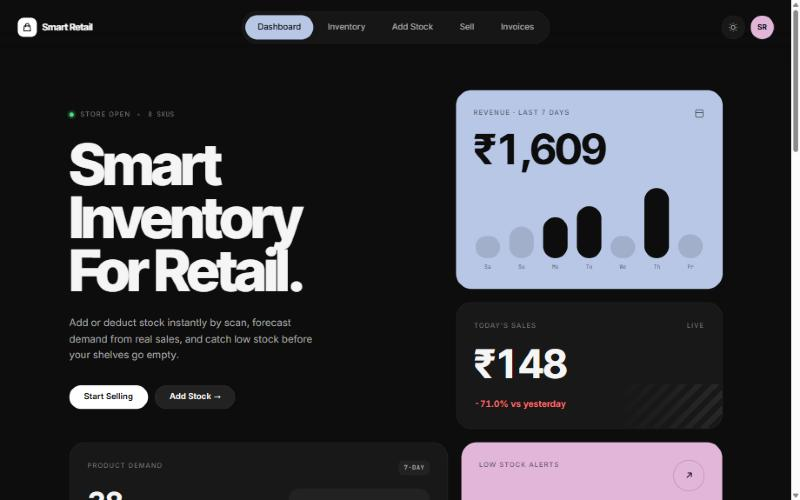
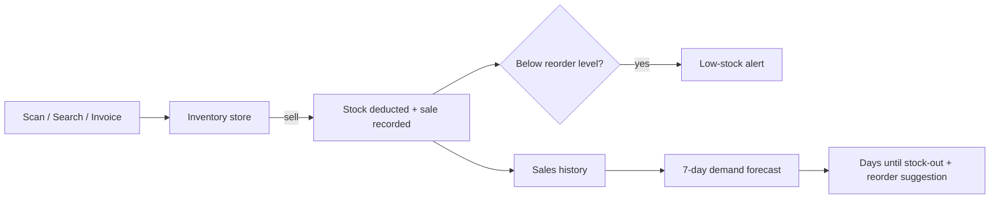

<div align="center">

# Smart Retail

**Smart inventory for small retail stores.**
Add or deduct stock instantly by scan, forecast demand from real sales, and catch low stock before the shelves go empty.

[](https://avaneendhra.github.io/retail-pro-prototype/)
&nbsp;


<br />

<a href="https://avaneendhra.github.io/retail-pro-prototype/">
  
</a>

</div>

---

## Try it

**Live app:** https://avaneendhra.github.io/retail-pro-prototype/

No sign-up or backend needed. The app comes loaded with sample products and a week of sales so every screen has data. Everything you do is saved in your own browser, so you can experiment freely.

> **Tip:** Open it on your phone to use the camera for barcode and label scanning. You can also install it to your home screen as an app (PWA).

---

## Features

| | Feature | What it does |
|---|---|---|
| ➕ | **Instant stock-in** | Scan a barcode, point the camera at a product label (AI text recognition), or enter it manually. Existing products get their quantity topped up automatically. |
| 🛒 | **Instant sell / checkout** | Scan or search a product and sell it in one tap. Stock is deducted immediately and a running session total is kept. Works without a camera in **Manual** mode. |
| 🔮 | **Demand forecasting** | Uses the last 7 days of sales to project next week's demand, estimate how many days until each product runs out, and suggest a reorder quantity. |
| ⚠️ | **Low-stock notifications** | A toast alert fires the moment a sale drops a product to or below its reorder level, and the dashboard lists every product that needs restocking. |
| 🧾 | **Invoice import** | Upload a wholesaler's bill to add many products to inventory in one go. |
| 📊 | **Live dashboard** | Weekly revenue, today's sales vs yesterday, top sellers, stock health, inventory value and stock by category. |
| 🌗 | **Dark & light themes** | A dark "bento" design by default, with a light mode one click away. Fully responsive, with a bottom nav on mobile. |

---

## How it works



**Forecast formula:**

- `avg per day` = units sold in the last 7 days ÷ 7
- `runs out in` = current stock ÷ avg per day
- `suggested reorder` = (expected weekly demand + reorder level) − current stock

---

## Pages

| Route | Page |
|---|---|
| `#/dashboard` | Overview, analytics, forecast and alerts |
| `#/inventory` | Full catalogue with search, category filter and stock levels |
| `#/add-stock` | Add stock by AI scan, barcode or manual entry |
| `#/sell` | Sell by AI scan, barcode or manual search |
| `#/invoice` | Bulk-import products from a wholesaler invoice |

---

## Tech stack

- **React 18** with **React Router** (hash routing, so it works on GitHub Pages)
- **Vite 4** for dev server and builds
- **Tailwind CSS 3** plus a CSS-variable design system (`src/index.css`)
- **html5-qrcode** for barcode scanning
- **Tesseract.js** for on-device text recognition of product labels
- **vite-plugin-pwa** for offline support and installability
- **Electron** (optional) for a desktop build

Data lives in `localStorage` through `InventoryContext`, so the prototype needs no server.

---

## Run locally

**Requirements:** Node.js 18 or newer.

```bash
git clone https://github.com/Avaneendhra/retail-pro-prototype.git
cd retail-pro-prototype
npm install
npm run dev
```

Then open **http://localhost:5173/retail-pro-prototype/**.

| Command | Description |
|---|---|
| `npm run dev` | Start the dev server with hot reload |
| `npm run build` | Production build into `dist/` |
| `npm run preview` | Serve the production build locally |
| `npm run deploy` | Build and publish to GitHub Pages |
| `npm run electron:start` | Run as a desktop app |
| `npm run electron:build` | Package a Windows desktop build |

> **Reset the demo data:** open the browser console on the app and run `localStorage.clear()`, then reload.

---

## Project structure

```
src/
├── main.jsx                  # Router + providers
├── index.css                 # Design system (theme tokens, cards, pills)
├── context/
│   ├── InventoryContext.jsx  # Products, sales, add/sell logic, low-stock alerts
│   ├── ThemeContext.jsx      # Dark / light mode
│   └── ToastContext.jsx      # Notifications
└── components/
    ├── layout/AppShell.jsx   # Top pill nav + mobile bottom nav
    ├── dashboard/            # Dashboard + demand forecast
    └── inventory/            # Inventory, AddStock, SellProduct, InvoiceScanner
```

---

## Deploying

The app is hosted on **GitHub Pages** from the `gh-pages` branch:

```bash
npm run deploy
```

The Vite `base` is set to `/retail-pro-prototype/` in `vite.config.mjs`. If you rename the repository, update it to match.

---

## Roadmap

- [ ] Connect to the Spring Boot + MongoDB backend for multi-device sync
- [ ] Bills and GST invoices with printable receipts
- [ ] Customer records and loyalty
- [ ] Multi-language UI (English, Hindi, Marathi, Telugu)
- [ ] Push notifications for low stock

---

<div align="center">

Made for small shops that deserve big-store tools.

</div>
