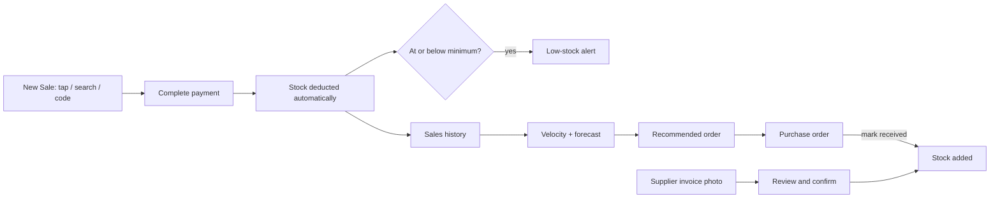

# Smart Retail

Inventory for small retail stores. Add or deduct stock by scan, forecast demand from sales, and see low stock before it runs out.

[Live demo](https://avaneendhra.github.io/retail-pro-prototype/) · [Run locally](#run-locally)

<a href="https://avaneendhra.github.io/retail-pro-prototype/">
  
</a>

## Try it

No sign-up or backend. The app ships with sample products and a week of sales, and saves changes in your browser.

Open it on a phone to use the camera for barcode and label scanning. It can also be installed to the home screen.

## Features

| Feature | Description |
|---|---|
| New Sale (POS billing) | The main screen. Add items three ways: tap a quick-access button, search by name, ID or code, or type a code such as `ML 2` or `P1025`. Price and stock are filled in automatically. Barcode scanning is also available. |
| Automatic inventory update | Completing payment deducts every item from stock at once and shows a before/after summary. No need to open Inventory after a sale. |
| Supplier invoice reading | Take a photo or upload a supplier bill. The app reads the supplier, invoice number and items, then shows a review screen. Stock changes only after you confirm. |
| Stock velocity | For each product: current stock, average daily sales, demand trend, predicted demand, days until it runs out, and a recommended order quantity with a plain-language reason. |
| Low-stock monitoring | Products at or below their minimum stock are flagged automatically on the dashboard, in the notification bell, and in Inventory. |
| Purchase orders | Create an order from a recommendation, share it on WhatsApp or print it, and mark it received to add the stock. |
| Sales forecasting | Expected sales for next week, fast- and slow-moving products, products likely to run out, and recommended reorders, written in plain language. |
| Four languages | English, Telugu, Hindi and Marathi, including product names. Switch from the language menu at the top. |

## How it works



How the numbers are worked out:

- `average daily sales` = units sold in the last 7 days ÷ 7
- `demand trend` = this week's daily average compared with last week's (up or down by more than 10%)
- `lasts about` = current stock ÷ average daily sales
- `recommended order` = expected sales over the cover period (3 days for perishables, 7 for others) + minimum stock − current stock

## Pages

| Route | Page |
|---|---|
| `#/billing` | New Sale (POS billing), the default screen |
| `#/dashboard` | Sales, forecast, insights and alerts |
| `#/inventory` | Stock list with velocity and recommendations |
| `#/invoices` | Supplier invoice upload and review |
| `#/orders` | Purchase orders |
| `#/add-stock` | Add products by label scan, barcode or by hand |

## Tech stack

- **React 18** with **React Router** (hash routing, so it works on GitHub Pages)
- **Vite 4** for dev server and builds
- **Tailwind CSS 3** plus a CSS-variable design system (`src/index.css`)
- **html5-qrcode** for barcode scanning
- **Tesseract.js** for on-device text recognition of labels and invoices
- **Claude** (optional, with your own Anthropic API key in Settings) for more accurate invoice reading
- **i18next** for English, Telugu, Hindi and Marathi
- **vite-plugin-pwa** for offline support and installability
- **Electron** (optional) for a desktop build

Data lives in `localStorage` through `InventoryContext`, so the prototype needs no server.

## Run locally

**Requirements:** Node.js 18 or newer.

```bash
git clone https://github.com/Avaneendhra/retail-pro-prototype.git
cd retail-pro-prototype
npm install
npm run dev
```

Then open **http://localhost:5173/retail-pro-prototype/**.

| Command | Description |
|---|---|
| `npm run dev` | Start the dev server with hot reload |
| `npm run build` | Production build into `dist/` |
| `npm run preview` | Serve the production build locally |
| `npm run deploy` | Build and publish to GitHub Pages |
| `npm run electron:start` | Run as a desktop app |
| `npm run electron:build` | Package a Windows desktop build |

To reset the demo data, run `localStorage.clear()` in the browser console and reload.

## Project structure

```
src/
├── main.jsx                    # Routes + providers
├── i18n.js                     # Language setup
├── locales/app/                # en, te, hi, mr translations
├── data/seed.js                # Demo products + 4 weeks of sales history
├── lib/
│   ├── insights.js             # Velocity, trends, forecasts, recommendations
│   ├── invoiceParser.js        # OCR text -> supplier, invoice no., items
│   └── claudeInvoice.js        # Optional Claude vision reading
├── context/InventoryContext.jsx # Products, bills, stock updates, purchase orders
└── components/
    ├── billing/                # New Sale (POS)
    ├── dashboard/              # Forecasts and insights
    ├── inventory/              # Stock velocity, Add Stock
    ├── invoice/                # Supplier invoice reading + review
    ├── orders/                 # Purchase orders
    └── layout/                 # Top bar, language menu, settings
```

## Deploying

The app is hosted on **GitHub Pages** from the `gh-pages` branch:

```bash
npm run deploy
```

The Vite `base` is set to `/retail-pro-prototype/` in `vite.config.mjs`. If you rename the repository, update it to match.

## Invoice reading

Without any setup, invoices are read on the device with Tesseract OCR. For better accuracy on real, messy bills, open **Settings** and paste an Anthropic API key. Invoices are then read with Claude. The key is stored only in that browser. Either way, nothing is added to inventory until you review and confirm.

## Roadmap

- [ ] Connect to the Spring Boot + MongoDB backend for multi-device sync
- [ ] GST invoices
- [ ] Customer records and loyalty
- [ ] Push notifications for low stock

