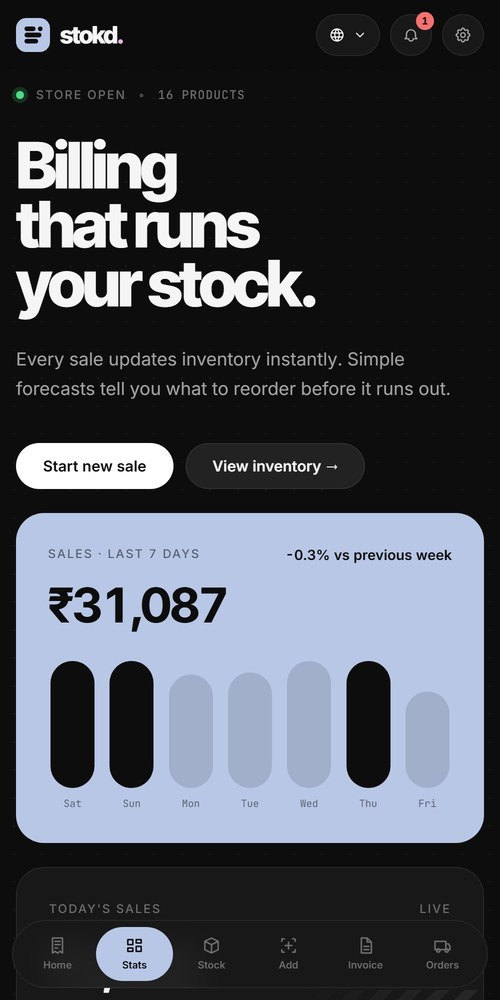
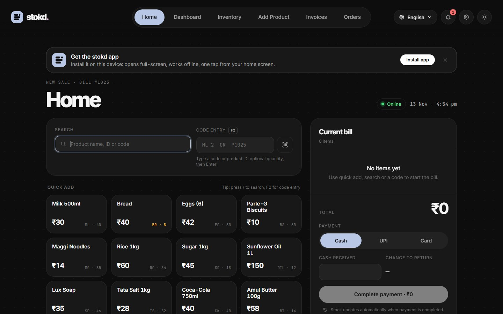
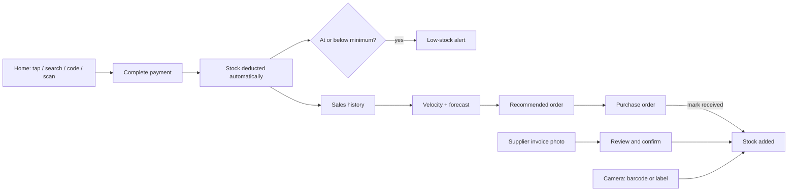

# stokd.

Billing and stock for small retail shops. Every sale updates inventory automatically, products are added by pointing the camera at them, and simple forecasts tell you what to reorder before it runs out.

**[Open the live app →](https://avaneendhra.github.io/retail-pro-prototype/)** · [Install on your phone](#install-on-your-phone) · [Run locally](#run-locally)

<p>
  <a href="https://avaneendhra.github.io/retail-pro-prototype/#/dashboard"></a>
  &nbsp;
  <a href="https://avaneendhra.github.io/retail-pro-prototype/#/dashboard"></a>
</p>

No sign-up, no server, no paid services. The app comes with 16 sample products and four weeks of sales history so every screen has data, and it saves changes in your browser.

## Install on your phone

stokd is an installable app (PWA). Open the live link on your phone:

- **Android (Chrome):** tap **Install app** on the banner, or menu → **Install app**.
- **iPhone (Safari):** tap **Share** → **Add to Home Screen**.

It then opens full-screen from your home screen, works offline (barcode scanning included), and has shortcuts for New sale, Add product and Inventory.

## Features

| | |
|---|---|
| **Home: billing** | The main screen. Add items by tapping a quick button, searching by name, ID or code, typing a code such as `ML 2` or `P1025`, or scanning a barcode. Price and stock fill in automatically. |
| **Automatic stock update** | Completing payment deducts every item at once and shows the before and after for each one. |
| **Add Product by camera** | Show products to the camera one by one. Each is recognised and added automatically: by barcode (your stock, then Open Food / Beauty / Products Facts), or from the label when there is no barcode (name, size and MRP). Undo and +1 are one tap away. |
| **Supplier invoices** | Photograph or upload a supplier bill. The supplier, invoice number and items are read, then shown for review. Stock changes only after you confirm. |
| **Stock velocity** | Per product: stock, average daily sales, demand trend, predicted demand, days until it runs out, and a recommended order with a plain reason. |
| **Low-stock alerts** | Products at or below their minimum are flagged on the dashboard, in the notification bell and in Inventory. |
| **Purchase orders** | Created from recommendations. Share on WhatsApp or print, then mark received to add the stock. |
| **Forecasting** | Expected sales for next week, fast and slow movers, what is likely to run out, and what to reorder, in everyday language. |
| **Four languages** | English, Telugu, Hindi and Marathi, product names included. |



## How it works



How the numbers are worked out:

- **Average daily sales** = units sold in the last 7 days ÷ 7
- **Demand trend** = this week's daily average vs last week's (up or down by more than 10%)
- **Lasts about** = current stock ÷ average daily sales
- **Recommended order** = expected sales over the cover period (3 days for perishables, 7 for others) + minimum stock − current stock

## Pages

| Route | Page |
|---|---|
| `#/home` | Home: billing, the default screen |
| `#/dashboard` | Sales, forecast, insights and alerts |
| `#/inventory` | Stock list with velocity and recommendations |
| `#/add-stock` | Add Product: automatic camera scanning |
| `#/invoices` | Supplier invoice upload and review |
| `#/orders` | Purchase orders |

## Tech stack

- **React 18** + **React Router** (hash routing, works on GitHub Pages)
- **Vite 4** and **vite-plugin-pwa** (offline support, installable app)
- **Tailwind CSS 3** with a CSS-variable design system
- **zxing-wasm** (ZXing C++ in WebAssembly) for barcodes, using the browser's own BarcodeDetector when available
- **Tesseract.js** for on-device reading of labels and invoices
- **i18next** for the four languages

Everything runs in the browser and data is kept in `localStorage`. Claude vision is supported as an optional extra (Settings → API key) but is not needed.

## Run locally

Requires Node.js 18 or newer.

```bash
git clone https://github.com/Avaneendhra/retail-pro-prototype.git
cd retail-pro-prototype
npm install
npm run dev
```

Then open http://localhost:5173/retail-pro-prototype/

| Command | What it does |
|---|---|
| `npm run dev` | Dev server with hot reload |
| `npm run build` | Production build into `dist/` |
| `npm run preview` | Serve the production build |
| `npm run deploy` | Build and publish to GitHub Pages |

To reset the demo data, use **Settings → Reset demo data**.

## Project structure

```
src/
├── main.jsx                     Routes and providers
├── i18n.js, locales/app/        English, Telugu, Hindi, Marathi
├── data/seed.js                 Demo products and 4 weeks of sales
├── context/InventoryContext.jsx Products, bills, stock updates, purchase orders
├── lib/
│   ├── insights.js              Velocity, trends, forecasts, recommendations
│   ├── scanEngine.js            Camera, barcode detection, label OCR
│   ├── productLookup.js         Barcode databases, label parsing, matching
│   ├── invoiceParser.js         Invoice text → supplier, number, items
│   └── install.js               "Install app" prompt
└── components/
    ├── billing/                 Home (POS) and barcode scanner
    ├── dashboard/               Forecasts and insights
    ├── inventory/               Inventory and Add Product
    ├── invoice/                 Supplier invoice reading and review
    ├── orders/                  Purchase orders
    └── layout/                  Top bar, logo, language menu, settings
```

## Contributing

Work happens on a branch and is merged into `master` through a pull request. GitHub Pages serves the `gh-pages` branch, which `npm run deploy` updates.

## Roadmap

- [ ] Sync across devices (backend)
- [ ] GST invoices
- [ ] Customer records and loyalty
- [ ] Push notifications for low stock
