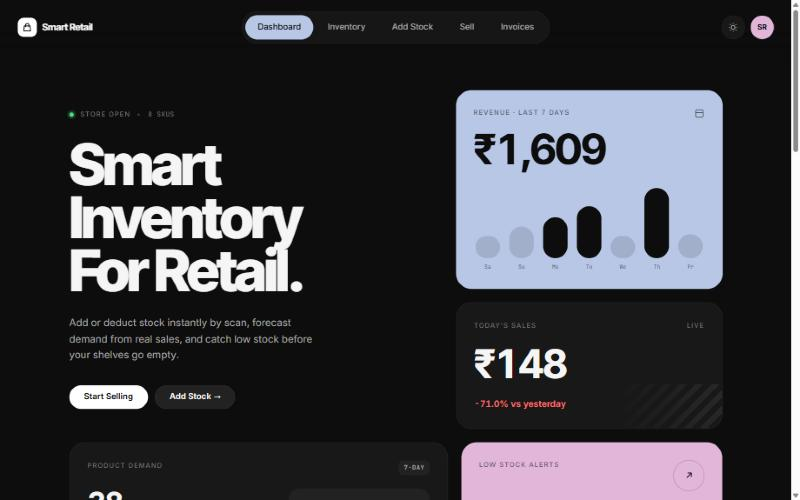
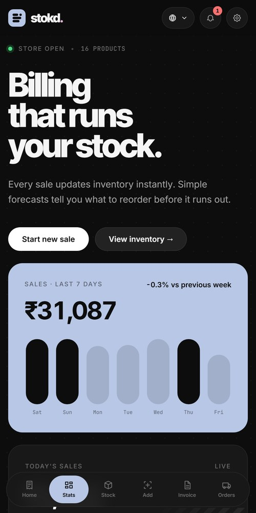
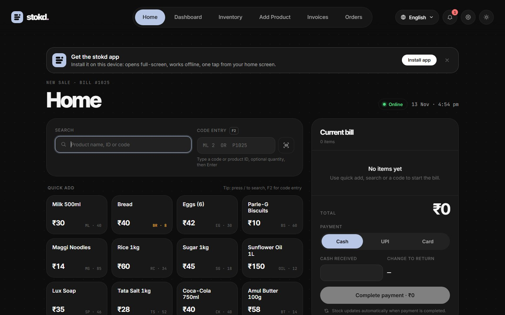
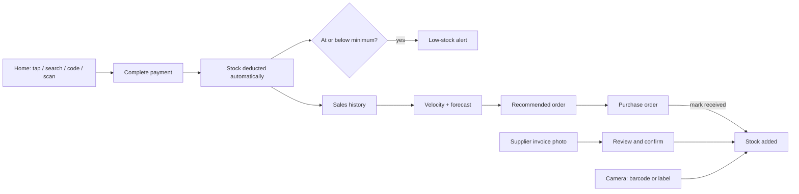

# stokd.

Billing and stock for small retail shops. Every sale updates inventory automatically, products are added by pointing the camera at them, and simple forecasts tell you what to reorder before it runs out.

**[Open the live app →](https://avaneendhra.github.io/retail-pro-prototype/)** · [Install on your phone](#install-on-your-phone) · [Run locally](#run-locally)

<p>
  <a href="https://avaneendhra.github.io/retail-pro-prototype/#/dashboard"></a>
  &nbsp;
  <a href="https://avaneendhra.github.io/retail-pro-prototype/#/dashboard"></a>
</p>

No sign-up, no server, no paid services. The app comes with 16 sample products and four weeks of sales history so every screen has data, and it saves changes in your browser.

## Install on your phone

stokd is an installable app (PWA). Open the live link on your phone:

- **Android (Chrome):** tap **Install app** on the banner, or menu → **Install app**.
- **iPhone (Safari):** tap **Share** → **Add to Home Screen**.

It then opens full-screen from your home screen, works offline (barcode scanning included), and has shortcuts for New sale, Add product and Inventory.

## Features

| | |
|---|---|
| **Home: billing** | The main screen. Add items by tapping a quick button, searching by name, ID or code, typing a code such as `ML 2` or `P1025`, or scanning a barcode. Price and stock fill in automatically. |
| **Automatic stock update** | Completing payment deducts every item at once and shows the before and after for each one. |
| **Add Product by camera** | Show products to the camera one by one. Each is recognised and added automatically: by barcode (your stock, then Open Food / Beauty / Products Facts), or from the label when there is no barcode (name, size and MRP). Undo and +1 are one tap away. |
| **Supplier invoices** | Photograph or upload a supplier bill. The supplier, invoice number and items are read, then shown for review. Stock changes only after you confirm. |
| **Stock velocity** | Per product: stock, average daily sales, demand trend, predicted demand, days until it runs out, and a recommended order with a plain reason. |
| **Low-stock alerts** | Products at or below their minimum are flagged on the dashboard, in the notification bell and in Inventory. |
| **Purchase orders** | Created from recommendations. Share on WhatsApp or print, then mark received to add the stock. |
| **Forecasting** | Expected sales for next week, fast and slow movers, what is likely to run out, and what to reorder, in everyday language. |
| **Four languages** | English, Telugu, Hindi and Marathi, product names included. |



## How it works



How the numbers are worked out:

- **Average daily sales** = units sold in the last 7 days ÷ 7
- **Demand trend** = this week's daily average vs last week's (up or down by more than 10%)
- **Lasts about** = current stock ÷ average daily sales
- **Recommended order** = expected sales over the cover period (3 days for perishables, 7 for others) + minimum stock − current stock

## Pages

| Route | Page |
|---|---|
| `#/home` | Home: billing, the default screen |
| `#/dashboard` | Sales, forecast, insights and alerts |
| `#/inventory` | Stock list with velocity and recommendations |
| `#/add-stock` | Add Product: automatic camera scanning |
| `#/invoices` | Supplier invoice upload and review |
| `#/orders` | Purchase orders |

## Accounts and sync

stokd works without an account: everything is kept on the device. With a free shop account, the same stock, bills and orders appear on every phone and computer the shop uses.

- **Offline first.** A sale shows at once and is saved on the device. It is sent when the internet is there.
- **Never counted twice, never lost.** Every change has its own id, and stock moves by amounts ("minus 2"), so two tills selling at the same time add up correctly.
- **Owner and staff logins.** Sign in with a phone number or email and a password. A recovery code replaces email and SMS, so nothing costs money.
- **Free to run.** The server is one small program on a SQLite database. It runs on Cloudflare's free plan, or on any computer with Node.

See **[docs/LAUNCH.md](docs/LAUNCH.md)** for putting it online.

## Tech stack

**App**

- **React 18** + **React Router 7** (hash routing, works on GitHub Pages)
- **Vite 8** and **vite-plugin-pwa** (offline support, installable app)
- **Tailwind CSS 3** with a CSS-variable design system
- **IndexedDB** for the shop's data on the device, with a queue of changes waiting to be sent
- **zxing-wasm** (ZXing C++ in WebAssembly) for barcodes, using the browser's own BarcodeDetector when available
- **Tesseract.js** for on-device reading of labels and invoices
- **i18next** for the four languages

**Server** (`server/`)

- **Hono** API with **zod** validation
- **SQLite**: Cloudflare **D1** when hosted on Workers, a plain file through Node's built-in driver otherwise
- Passwords are stretched in the browser (PBKDF2, 600,000 rounds) and only a salted hash is stored

**Tests**: `node --test` for the server, **Vitest** + Testing Library for the app. The app's sync tests run two simulated devices against the real server code.

Claude vision is supported as an optional extra (Settings → API key) but is not needed.

## Run locally

Requires Node.js 22.13 or newer.

```bash
git clone https://github.com/Avaneendhra/retail-pro-prototype.git
cd retail-pro-prototype
npm install
npm start
```

Then open http://localhost:8787. That one command builds the app and starts the server with its database in `server/data/`.

| Command | What it does |
|---|---|
| `npm start` | Build the app and run it with the server on port 8787 |
| `npm run dev` | App only, with hot reload, at http://localhost:5173/retail-pro-prototype/ |
| `npm run dev:api` | Server only (the dev app talks to it automatically) |
| `npm test` | All server and app tests |
| `npm run smoke -- http://localhost:8787` | Check a running server end to end |
| `npm run build` | Build for GitHub Pages into `dist/` |
| `npm run deploy` | Build and publish to GitHub Pages |
| `npm run launch` | Build and deploy to Cloudflare (see docs/LAUNCH.md) |

Without an account, **Settings → Reset demo data** restores the sample shop.

## Project structure

```
src/
├── main.jsx                     Routes and providers
├── i18n.js, locales/app/        English, Telugu, Hindi, Marathi
├── data/seed.js                 Sample products and 4 weeks of sales
├── store/                       The shop's data, with no React in it
│   ├── engine.js                Local mode, accounts, the queue of unsent changes, sync
│   ├── ops.js, merge.js         What each change does; folding in rows from the server
│   ├── storage.js               IndexedDB (with a memory fallback that says so)
│   ├── api.js, ids.js           HTTP client; bill, order and product numbers
│   └── legacy.js, history.js    Taking over data saved by older versions
├── context/
│   ├── InventoryContext.jsx     useInventory() and useAccount() for the screens
│   └── boot.js                  Starts the engine once per page
├── lib/                         Insights, scanning, label and invoice reading
└── components/
    ├── billing/                 Home (POS) and barcode scanner
    ├── account/                 Sign in, create account, sync status, staff logins
    ├── dashboard/, inventory/, invoice/, orders/
    └── layout/                  Top bar, start-up screens, settings

server/
├── migrations/                  Database schema
├── src/
│   ├── app.js                   The API (same code on Cloudflare and Node)
│   ├── auth.js, team.js         Accounts, tokens, staff logins
│   ├── ops.js, sync.js          Applying changes; POST /api/sync
│   ├── db/                      SQLite adapters: Node file and Cloudflare D1
│   ├── node.js, worker.js       The two ways to run it
├── scripts/smoke.mjs            End-to-end check of a running server
└── test/                        Server tests

shared/auth.js                   Login clean-up and password stretching (app and server)
docs/LAUNCH.md                   How to put it online
```

## Contributing

Work happens on a branch and is merged into `master` through a pull request. GitHub Pages serves the `gh-pages` branch, which `npm run deploy` updates.

## Roadmap

- [x] Accounts and sync across devices
- [ ] GST invoices
- [ ] Customer records and loyalty
- [ ] Push notifications for low stock
