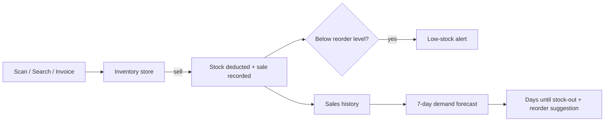

# Smart Retail

Inventory for small retail stores. Add or deduct stock by scan, forecast demand from sales, and see low stock before it runs out.

[Live demo](https://avaneendhra.github.io/retail-pro-prototype/) · [Run locally](#run-locally)

<a href="https://avaneendhra.github.io/retail-pro-prototype/">
  
</a>

## Try it

No sign-up or backend. The app ships with sample products and a week of sales, and saves changes in your browser.

Open it on a phone to use the camera for barcode and label scanning. It can also be installed to the home screen.

## Features

| Feature | Description |
|---|---|
| Stock in | Add products by barcode, by reading the label with the camera, or by hand. Existing products are topped up. |
| Sell | Scan or search a product and sell it. Stock is deducted immediately. Manual mode works without a camera. |
| Demand forecast | Projects next week's demand from the last 7 days of sales, with days until stock-out and a suggested reorder quantity. |
| Low-stock alerts | Notifies you when a sale takes a product to or below its reorder level. |
| Invoice import | Adds many products at once from a wholesaler bill. |
| Dashboard | Weekly revenue, today's sales, top sellers, stock health, inventory value and stock by category. |
| Themes | Dark by default, with a light mode. Responsive down to phone width. |

## How it works



Forecast:

- `avg per day` = units sold in the last 7 days ÷ 7
- `runs out in` = current stock ÷ avg per day
- `suggested reorder` = (expected weekly demand + reorder level) − current stock

## Pages

| Route | Page |
|---|---|
| `#/dashboard` | Overview, analytics, forecast and alerts |
| `#/inventory` | Full catalogue with search, category filter and stock levels |
| `#/add-stock` | Add stock by AI scan, barcode or manual entry |
| `#/sell` | Sell by AI scan, barcode or manual search |
| `#/invoice` | Bulk-import products from a wholesaler invoice |

## Tech stack

- **React 18** with **React Router** (hash routing, so it works on GitHub Pages)
- **Vite 4** for dev server and builds
- **Tailwind CSS 3** plus a CSS-variable design system (`src/index.css`)
- **html5-qrcode** for barcode scanning
- **Tesseract.js** for on-device text recognition of product labels
- **vite-plugin-pwa** for offline support and installability
- **Electron** (optional) for a desktop build

Data lives in `localStorage` through `InventoryContext`, so the prototype needs no server.

## Run locally

**Requirements:** Node.js 18 or newer.

```bash
git clone https://github.com/Avaneendhra/retail-pro-prototype.git
cd retail-pro-prototype
npm install
npm run dev
```

Then open **http://localhost:5173/retail-pro-prototype/**.

| Command | Description |
|---|---|
| `npm run dev` | Start the dev server with hot reload |
| `npm run build` | Production build into `dist/` |
| `npm run preview` | Serve the production build locally |
| `npm run deploy` | Build and publish to GitHub Pages |
| `npm run electron:start` | Run as a desktop app |
| `npm run electron:build` | Package a Windows desktop build |

To reset the demo data, run `localStorage.clear()` in the browser console and reload.

## Project structure

```
src/
├── main.jsx                  # Router + providers
├── index.css                 # Design system (theme tokens, cards, pills)
├── context/
│   ├── InventoryContext.jsx  # Products, sales, add/sell logic, low-stock alerts
│   ├── ThemeContext.jsx      # Dark / light mode
│   └── ToastContext.jsx      # Notifications
└── components/
    ├── layout/AppShell.jsx   # Top pill nav + mobile bottom nav
    ├── dashboard/            # Dashboard + demand forecast
    └── inventory/            # Inventory, AddStock, SellProduct, InvoiceScanner
```

## Deploying

The app is hosted on **GitHub Pages** from the `gh-pages` branch:

```bash
npm run deploy
```

The Vite `base` is set to `/retail-pro-prototype/` in `vite.config.mjs`. If you rename the repository, update it to match.

## Roadmap

- [ ] Connect to the Spring Boot + MongoDB backend for multi-device sync
- [ ] Bills and GST invoices with printable receipts
- [ ] Customer records and loyalty
- [ ] Multi-language UI (English, Hindi, Marathi, Telugu)
- [ ] Push notifications for low stock

